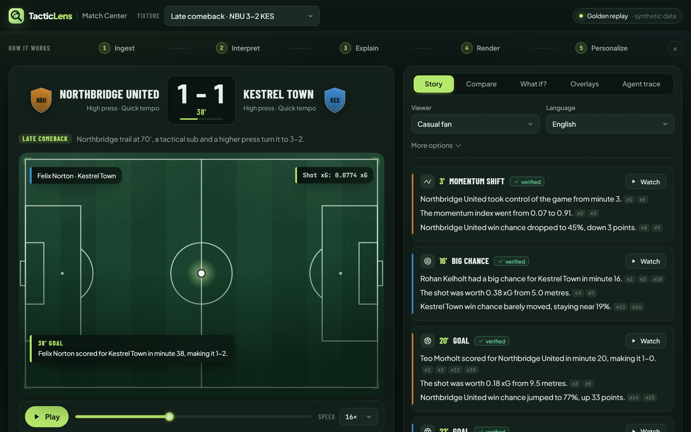
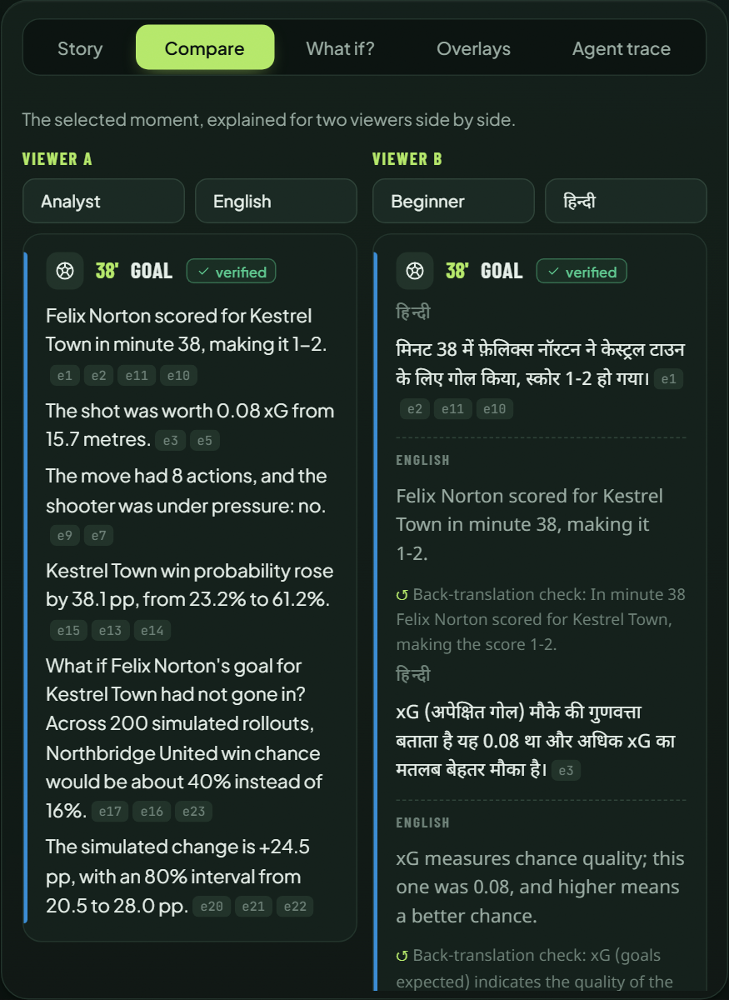

# TacticLens

**An AI match-intelligence engine on Azure that turns synthetic football events into explained, personalized and accessible match stories.**

Ingest → Interpret → Explain → Render → Personalize. Every sentence the AI writes cites its evidence, and a deterministic verifier rejects any number that the evidence does not back.

- **Live demo:** https://ca-tacticlens-bwdo4r22di23o.ambitiousocean-8d1c2333.francecentral.azurecontainerapps.io
- **Video (under 2 min):** _link added at submission_
- **Categories:** Grand Prize · Best Use of Microsoft Foundry · Best Multi-Agent System

> All clubs, players and matches are fictional and generated by our own simulator. No real leagues, clubs, players or logos are used.



## The problem

A scoreline does not explain a game. Analysts want the numbers, casual fans want the story, beginners need the terms explained, and blind or low-vision fans need a description they can listen to. Fans also follow games in many languages. Broadcasters want all of this as on-screen graphics they can trust. Generative AI can write these stories, but it also invents numbers. TacticLens writes the stories from computed evidence only, and it checks every claim before a viewer sees it.

## What makes it different

1. **Real models and counterfactuals.** We trained xG (logistic regression), xT (value iteration) and win-probability (gradient boosting) models on 3,000 simulated matches. A Monte-Carlo engine answers "what if?". It replays the rest of the match 200 times from a moment, with one thing changed, and reports the change in win chance with an 80% interval.
2. **Grounded explanations.** The Explainer agent returns JSON sentences, and each sentence lists its `evidence_ids`. The Verifier checks every number, citation, club and name against the evidence pack. A failed draft goes back to the Explainer with the verifier notes, up to 2 times. After that, the workflow uses a verified template. On injected faults the verifier catches 100% in all 8 fault classes.
3. **Localized and accessible personalization.** There are four viewer personas: analyst, casual, beginner and audio description. There are three languages (English, Hindi, Spanish), and every translation shows its English source and a back-translation check beside it. The engine also supports a cricket analogy pack, a favourite club and player, and a player-lock mode. Audio descriptions use Azure AI Speech, and an ARIA live region carries the captions.



## Architecture

```mermaid
flowchart LR
  subgraph Interpret["Ingest + Interpret (deterministic Python)"]
    SIM[Possession-chain simulator<br/>team style params, story beats] --> MET[xG · xT · win probability<br/>momentum · PPDA]
    MET --> MOM[Moment detector<br/>+ evidence packs]
    MOM --> CF[Counterfactual engine<br/>200 Monte-Carlo rollouts]
  end
  subgraph Agents["Explain: Microsoft Agent Framework workflow"]
    EXP[Explainer agent<br/>Microsoft Foundry] --> VER{Verifier<br/>deterministic checks + LLM judge}
    VER -- "rejected, max 2 retries" --> EXP
    VER -- "still failing" --> TPL[Template fallback]
    VER -- verified --> LOC[Localizer agent<br/>hi · es, numeral and entity checks]
    TPL --> LOC
    LOC --> A11Y[Accessibility describer<br/>speech and ARIA text]
    A11Y --> SAFE[SafetyGate<br/>Azure AI Content Safety]
  end
  subgraph Out["Render + Personalize"]
    REN[Overlay cue renderer<br/>OverlayCue JSON]
    PER[Persona engine<br/>analyst · casual · beginner · audio]
    TTS[Azure AI Speech<br/>cached mp3]
  end
  CF --> EXP
  MOM --> EXP
  SAFE --> REN & PER & TTS
  REN & PER & TTS --> API[FastAPI + SSE replay<br/>Azure Container Apps]
  API --> WEB[Match Center<br/>vanilla JS + SVG]
  API <--> DB[(Azure Cosmos DB<br/>moments + explanations)]
  API -.-> AI[Application Insights]
```



**Agents and handoffs.** The workflow runs Spotter, EvidenceBuilder, Explainer, Verifier, TemplateFallback, Localizer, AccessibilityDescriber and SafetyGate. The Explainer and the Localizer are LLM agents on Microsoft Foundry, and the Verifier adds a small LLM judge after its deterministic checks. Every other step is plain code, so it is cheap and repeatable. A shared state object passes through the workflow, and every handoff, retry and fallback goes into a trace. The **Agent trace** tab shows that trace. It also has a switch that kills the Explainer, so you can watch the retries and the template fallback happen.

**Golden mode.** The workflow precomputes all outputs for the six demo matches and stores them in `data/golden/`. The site therefore works even if an Azure service is down. In live mode, the Agent trace tab re-runs the workflow on Microsoft Foundry and Azure AI Content Safety, and saves the result in Cosmos DB. Every model, Speech and Content Safety call is cached on disk by input hash.

| Azure service | Used for |
|---|---|
| Microsoft Foundry (gpt-5-mini deployment) | Explainer and verifier judge in live mode; Localizer for the Hindi and Spanish golden outputs |
| Azure Container Apps | Hosting (azd + Bicep, keyless user-assigned managed identity) |
| Azure Cosmos DB (serverless) | Moment and explanation store, with a local JSON fallback |
| Azure AI Speech | Audio-description TTS (en, hi, es) |
| Azure AI Content Safety | SafetyGate on every live explanation |
| Azure AI Translator | Fallback translation and the back-translation check |
| Application Insights | Request telemetry and container logs |

## Results

From [docs/evaluation.md](docs/evaluation.md), [docs/realism.md](docs/realism.md) and [docs/personalization.md](docs/personalization.md). CI regenerates these numbers and fails if they drift.

| What | Result |
|---|---|
| Simulator realism (9 metrics vs real-football target ranges) | 9 / 9 pass |
| xG model, held-out shots | ROC AUC 0.838, Brier 0.070, log loss 0.244 (oracle 0.243) |
| Win-probability model | log loss 0.650 (base rates 1.062); reliability table and calibration plot in the docs |
| Golden moments with a verified or template-fallback explanation | 100% (53 / 53) |
| Shipped sentences citing valid evidence | 100% (763 / 763) |
| Shipped numbers backed by cited evidence | 100% (1,448 / 1,448) |
| First drafts that passed the verifier | 77.8%; mean 1.24 Explainer attempts |
| Verifier catch rate on injected faults (8 classes) | 100% in every class |
| Localized sentences (hi, es) written by the Localizer agent | 1,526 / 1,526; no Translator or English fallback needed |

The English golden explanations come from the offline Explainer backend. This backend is a deterministic stand-in for the Foundry agent, and it adds simulated drift to first drafts so that the retry and fallback paths run. The Hindi and Spanish outputs come from Foundry. The live demo runs the same workflow on Foundry when you choose **Live** in the Agent trace tab.

## Try it (testing instructions)

Open the live demo. The first load can take about 20 seconds while the app starts.

1. Press **Play**, or press Space. Events stream onto the pitch over server-sent events, and the score, match stats and win-probability chart update as the clock runs.
2. Click any icon on the **Key moments** timeline. Overlay cues appear on the pitch, and the matching card is highlighted in **Story**. Click an evidence id such as `e3` to see the number it backs.
3. In **Story**, change **Viewer** and **Language**. Choose Hindi to see the English source and a back-translation check beside each sentence. Choose **Audio description** to get a playable audio track. **More options** has the favourite club and player, player-lock and cricket analogies.
4. **Compare** shows the same moment for two viewers side by side.
5. **What if?** shows the counterfactual for a goal, red card, substitution or press. For other moments, click **Simulate now** to run 200 rollouts live.
6. **Overlays** shows the broadcast cue JSON (OverlayCue contract). You can download it.
7. In **Agent trace**, turn on **Kill the Explainer agent** and click **Re-run agents**. The trace shows the retries and then the verified template fallback. Choose **Live** to run the workflow on Microsoft Foundry and Content Safety.

Keyboard: Space plays or pauses, ← and → jump 30 s, and [ and ] go to the previous or next moment. The page also supports screen readers, reduced motion and RTL layouts (add `?dir=rtl` to the URL).

## Run locally (golden mode, no Azure needed)

```
py -3.11 -m venv .venv
.venv\Scripts\activate          # Windows  (source .venv/bin/activate on macOS/Linux)
pip install -e .[dev]
pytest -q
uvicorn tacticlens.api.app:app --app-dir src --port 8000
```

Then open http://localhost:8000. To regenerate the six golden matches and the realism report, run `python -m tacticlens.sim all`. For live mode and the Azure deploy (`azd up`), see [docs/deploy.md](docs/deploy.md).

## Repository map

| Path | What |
|---|---|
| `contracts/` | JSON Schemas for Event, Moment, Explanation, OverlayCue and Persona; `src/tacticlens/contracts.py` mirrors them as pydantic v2 models |
| `src/tacticlens/sim` | Possession-chain simulator, golden matches, realism report |
| `src/tacticlens/metrics` | xG, xT, win probability, momentum, PPDA |
| `src/tacticlens/moments`, `counterfactual` | Moment detector, evidence packs, Monte-Carlo rollouts |
| `src/tacticlens/agents` | Agent Framework workflow, Explainer, Verifier, templates, eval harness |
| `src/tacticlens/personalize`, `render` | Personas, localization, cricket analogies, Speech; overlay cue renderer |
| `src/tacticlens/api`, `store` | FastAPI app with SSE replay; Cosmos DB store with JSON fallback |
| `web/` | Match Center: vanilla JS modules, CSS and SVG, no build step |
| `infra/`, `azure.yaml`, `.github/workflows` | Bicep + azd; CI (pytest, Playwright smoke test, eval drift check) and deploy |

## Judging criteria

| Criterion | Where to look |
|---|---|
| Technological implementation | Simulator with a realism report; trained models with calibration ([docs/evaluation.md](docs/evaluation.md)); typed contracts; 121 tests including a Playwright smoke test; CI; Bicep + azd |
| Agentic design and innovation | Distinct agent roles with a shared state; a verifier loop with retries and fallback; the Agent trace panel and kill switch; the counterfactual engine |
| Real-world impact | An overlay cue contract that broadcasters can use; three languages and an audio-description mode; grounded numbers; deployed on Azure |
| UX and presentation | The Match Center: replay, timeline, win-probability chart, persona compare, what-if and overlays, on desktop and mobile |
| Category adherence | Microsoft Foundry for the agents, Agent Framework for the workflow, and Azure AI Speech, Content Safety, Translator, Cosmos DB, Container Apps and App Insights around them |

## License

MIT. See [LICENSE](LICENSE).
