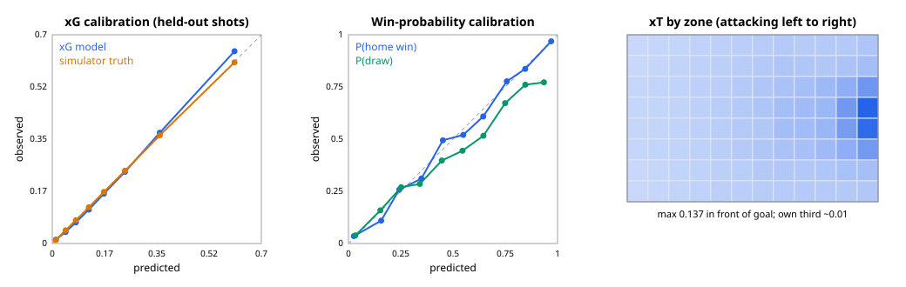

# Model evaluation

Trained on 3,000 fast-mode simulated league matches (seeded); every 5th match is held out.
Regenerate with `python -m tacticlens.metrics all` (models in `data/models/`, numbers in `data/models/eval.json`).

## Expected goals (logistic regression)

Features: shot distance, goal-mouth angle, header, under pressure, set piece. Because the data is synthetic, the simulator's hidden per-shot scoring probability is an oracle we can compare against.

| metric | value |
|---|---|
| held-out shots | 16,577 |
| goal rate | 0.0985 |
| log loss (model) | 0.244 |
| log loss (oracle: simulator truth) | 0.2431 |
| Brier score | 0.0704 |
| ROC AUC | 0.8382 |
| mean abs. error vs truth | 0.0098 |

Learned coefficients next to the simulator's (team-quality terms are hidden from the model):

| feature | learned | simulator |
|---|---|---|
| distance_m | -0.157942 | -0.16 |
| angle_rad | 0.648291 | 0.6 |
| header | -0.788226 | -0.9 |
| under_pressure | -0.376391 | -0.4 |
| set_piece | -0.055102 | 0 (direct free kicks x0.7) |

Calibration (held-out):

| xG bin | shots | mean xG | goal rate | true prob. |
|---|---|---|---|---|
| 0-0.03 | 6164 | 0.0121 | 0.0128 | 0.0121 |
| 0.03-0.06 | 2395 | 0.0447 | 0.0388 | 0.0444 |
| 0.06-0.1 | 2717 | 0.0789 | 0.071 | 0.0781 |
| 0.1-0.15 | 1933 | 0.1224 | 0.1138 | 0.1217 |
| 0.15-0.2 | 976 | 0.1731 | 0.167 | 0.173 |
| 0.2-0.3 | 1170 | 0.2434 | 0.2402 | 0.2442 |
| 0.3-0.45 | 673 | 0.3599 | 0.3715 | 0.3628 |
| 0.45-1.0 | 549 | 0.6103 | 0.6448 | 0.6075 |

## Expected threat (value iteration)

12x8 zone grid fitted on 300 full-mode matches: move/shot probabilities and a successful-move transition matrix, iterated to convergence. Max zone value 0.1367, own penalty area 0.009, opponent's central box zones 0.0941.

## Win probability (gradient boosting)

Features at each minute: minute, goal difference, total goals, man advantage, xG difference so far, pre-match team-quality difference. One snapshot every 3 minutes per match.

| metric | gradient boosting | multinomial logreg | base rates |
|---|---|---|---|
| log loss | 0.6504 | 0.662 | 1.062 |
| Brier (3-class) | 0.3759 | 0.3805 | - |

Log loss by match phase (it should fall as the match resolves):

| minutes | log loss |
|---|---|
| 0-30 | 0.884 |
| 30-60 | 0.7127 |
| 60-96 | 0.4039 |

Calibration of P(home win), held-out snapshots:

| bin | n | predicted | observed |
|---|---|---|---|
| 0.0-0.1 | 5363 | 0.026 | 0.0354 |
| 0.1-0.2 | 1796 | 0.1564 | 0.1097 |
| 0.2-0.3 | 1988 | 0.243 | 0.258 |
| 0.3-0.4 | 1379 | 0.3488 | 0.3111 |
| 0.4-0.5 | 1468 | 0.4517 | 0.4946 |
| 0.5-0.6 | 928 | 0.549 | 0.5205 |
| 0.6-0.7 | 654 | 0.6447 | 0.6086 |
| 0.7-0.8 | 1049 | 0.7575 | 0.7769 |
| 0.8-0.9 | 1139 | 0.8455 | 0.8367 |
| 0.9-1.0 | 3436 | 0.9697 | 0.9686 |

## Golden matches: final win probability and top-8 moments

Importance = kind base + effect size + win-probability swing (window moments get a small WP weight so goals inside their window do not dominate).

Counterfactuals (top 5 moments per match, at most 3 of one kind): the match is replayed to the moment, then 200 rest-of-match rollouts run as played and 200 with one change, paired by seed. The interval is a bootstrap 80% interval of the mean paired difference. A near-zero effect is a real answer: in the simulator a substitution only matters when it changes team style.

### GM01 Late comeback: Northbridge United 3-2 Kestrel Town

xG 1.677-1.188; final WP home/draw/away 0.92/0.07/0.00.

| min | kind | team | importance | WP before (H/D/A) | WP after |
|---|---|---|---|---|---|
| 20' | goal | Northbridge United | 0.77 | 0.44/0.36/0.20 | 0.77/0.15/0.08 |
| 22' | goal | Kestrel Town | 0.80 | 0.77/0.15/0.08 | 0.41/0.35/0.24 |
| 38' | goal | Kestrel Town | 0.82 | 0.36/0.40/0.23 | 0.11/0.28/0.61 |
| 39' | momentum_shift | Northbridge United | 0.46 | 0.36/0.40/0.23 | 0.08/0.29/0.63 |
| 62' | sub_effect | Northbridge United | 0.64 | 0.04/0.38/0.58 | 0.17/0.58/0.26 |
| 62' | momentum_shift | Northbridge United | 0.46 | 0.04/0.38/0.58 | 0.02/0.24/0.73 |
| 74' | goal | Northbridge United | 0.94 | 0.01/0.19/0.80 | 0.17/0.55/0.27 |
| 88' | goal | Northbridge United | 1.00 | 0.11/0.75/0.15 | 0.92/0.07/0.00 |

What-if rollouts (change in home win probability, mean and 80% interval):

| min | kind | what if | rollouts | mean | 80% interval |
|---|---|---|---|---|---|
| 38' | goal | What if Felix Norton's goal for Kestrel Town had not gone in | 200 | +0.245 | +0.205 to +0.280 |
| 62' | momentum_shift | What if Kestrel Town had pressed harder from this point | 200 | -0.020 | -0.050 to +0.010 |
| 62' | sub_effect | What if Northbridge United had kept Caio Ferrmere, Yusuf Draycroft on instead of bringing on Felix Norier, Elio Morstone | 200 | +0.010 | -0.030 to +0.050 |
| 74' | goal | What if Teo Morholt's goal for Northbridge United had not gone in | 200 | -0.250 | -0.290 to -0.210 |
| 88' | goal | What if Felix Norier's goal for Northbridge United had not gone in | 200 | -0.865 | -0.895 to -0.835 |

### GM02 Ten men: Harbor Athletic 1-0 Redmere FC

xG 1.411-1.908; final WP home/draw/away 0.96/0.04/0.00.

| min | kind | team | importance | WP before (H/D/A) | WP after |
|---|---|---|---|---|---|
| 4' | momentum_shift | Redmere FC | 0.34 | 0.43/0.34/0.23 | 0.36/0.43/0.21 |
| 24' | big_chance | Redmere FC | 0.33 | 0.36/0.44/0.20 | 0.39/0.41/0.21 |
| 27' | momentum_shift | Harbor Athletic | 0.47 | 0.34/0.48/0.18 | 0.39/0.39/0.23 |
| 34' | red_card | Redmere FC | 0.54 | 0.28/0.51/0.21 | 0.35/0.40/0.25 |
| 40' | goal | Harbor Athletic | 0.86 | 0.42/0.37/0.21 | 0.85/0.10/0.04 |
| 50' | momentum_shift | Redmere FC | 0.50 | 0.84/0.13/0.03 | 0.85/0.13/0.02 |
| 59' | sub_effect | Redmere FC | 0.47 | 0.85/0.13/0.02 | 0.92/0.07/0.01 |
| 84' | sub_effect | Redmere FC | 0.41 | 0.95/0.05/0.00 | 0.96/0.04/0.00 |

What-if rollouts (change in home win probability, mean and 80% interval):

| min | kind | what if | rollouts | mean | 80% interval |
|---|---|---|---|---|---|
| 27' | momentum_shift | What if Redmere FC had pressed harder from this point | 200 | -0.150 | -0.215 to -0.090 |
| 34' | red_card | What if Sami Gulholt had stayed on the pitch for Redmere FC | 200 | -0.205 | -0.270 to -0.140 |
| 40' | goal | What if Iker Morton's goal for Harbor Athletic had not gone in | 200 | -0.310 | -0.350 to -0.265 |
| 50' | momentum_shift | What if Harbor Athletic had pressed harder from this point | 200 | +0.030 | -0.015 to +0.075 |
| 59' | sub_effect | What if Redmere FC had kept Bruno Calvale on instead of bringing on Aleks Corholt | 200 | +0.000 | -0.045 to +0.050 |

### GM03 Derby draw: Greyhaven Rovers 2-2 Thornvale City

xG 2.186-0.931; final WP home/draw/away 0.06/0.92/0.03.

| min | kind | team | importance | WP before (H/D/A) | WP after |
|---|---|---|---|---|---|
| 3' | goal | Thornvale City | 0.72 | 0.49/0.20/0.30 | 0.24/0.22/0.54 |
| 3' | momentum_shift | Greyhaven Rovers | 0.37 | 0.47/0.21/0.32 | 0.24/0.19/0.56 |
| 22' | goal | Greyhaven Rovers | 0.73 | 0.36/0.13/0.52 | 0.48/0.28/0.24 |
| 45' | momentum_shift | Greyhaven Rovers | 0.35 | 0.39/0.33/0.28 | 0.40/0.36/0.24 |
| 60' | sub_effect | Thornvale City | 0.51 | 0.39/0.37/0.24 | 0.19/0.74/0.06 |
| 62' | goal | Greyhaven Rovers | 0.84 | 0.42/0.43/0.15 | 0.82/0.15/0.03 |
| 65' | sub_effect | Thornvale City | 0.65 | 0.82/0.15/0.03 | 0.16/0.78/0.06 |
| 66' | goal | Thornvale City | 1.00 | 0.84/0.14/0.02 | 0.23/0.62/0.14 |

What-if rollouts (change in home win probability, mean and 80% interval):

| min | kind | what if | rollouts | mean | 80% interval |
|---|---|---|---|---|---|
| 22' | goal | What if Femi Wynvale's goal for Greyhaven Rovers had not gone in | 200 | -0.205 | -0.240 to -0.170 |
| 60' | sub_effect | What if Thornvale City had kept Iker Garcroft on instead of bringing on Otto Garmere | 200 | +0.035 | -0.020 to +0.090 |
| 62' | goal | What if Mateo Gulholt's goal for Greyhaven Rovers had not gone in | 200 | -0.600 | -0.645 to -0.555 |
| 65' | sub_effect | What if Thornvale City had kept Arin Halbrook on instead of bringing on Jari Kelcroft | 200 | -0.060 | -0.105 to -0.010 |
| 66' | goal | What if Otto Garmere's goal for Thornvale City had not gone in | 200 | +0.630 | +0.585 to +0.670 |

### GM04 Press collapse: Kestrel Town 1-2 Harbor Athletic

xG 1.192-1.115; final WP home/draw/away 0.01/0.09/0.91.

| min | kind | team | importance | WP before (H/D/A) | WP after |
|---|---|---|---|---|---|
| 34' | momentum_shift | Kestrel Town | 0.44 | 0.42/0.37/0.21 | 0.55/0.28/0.17 |
| 41' | goal | Kestrel Town | 0.74 | 0.55/0.28/0.17 | 0.83/0.14/0.04 |
| 56' | momentum_shift | Kestrel Town | 0.54 | 0.71/0.26/0.03 | 0.87/0.11/0.02 |
| 60' | press_collapse | Kestrel Town | 0.69 | 0.85/0.13/0.02 | 0.89/0.10/0.01 |
| 62' | big_chance | Kestrel Town | 0.28 | 0.87/0.12/0.01 | 0.87/0.11/0.02 |
| 87' | goal | Harbor Athletic | 1.00 | 0.94/0.06/0.00 | 0.12/0.78/0.10 |
| 91' | goal | Harbor Athletic | 1.00 | 0.10/0.83/0.07 | 0.01/0.09/0.91 |

What-if rollouts (change in home win probability, mean and 80% interval):

| min | kind | what if | rollouts | mean | 80% interval |
|---|---|---|---|---|---|
| 41' | goal | What if Wen Morby's goal for Kestrel Town had not gone in | 200 | -0.375 | -0.420 to -0.330 |
| 56' | momentum_shift | What if Harbor Athletic had pressed harder from this point | 200 | -0.005 | -0.056 to +0.050 |
| 60' | press_collapse | What if Kestrel Town had kept pressing at their earlier intensity | 200 | +0.090 | +0.040 to +0.140 |
| 87' | goal | What if Otto Wynmore's goal for Harbor Athletic had not gone in | 200 | +0.840 | +0.805 to +0.875 |
| 91' | goal | What if Emre Brenmere's goal for Harbor Athletic had not gone in | 200 | +0.060 | +0.040 to +0.080 |

### GM05 The rout: Northbridge United 4-0 Elmstead Wanderers

xG 2.679-0.299; final WP home/draw/away 1.00/0.00/0.00.

| min | kind | team | importance | WP before (H/D/A) | WP after |
|---|---|---|---|---|---|
| 2' | goal | Northbridge United | 0.56 | 0.91/0.06/0.03 | 0.99/0.01/0.00 |
| 27' | momentum_shift | Northbridge United | 0.37 | 0.99/0.01/0.00 | 0.97/0.03/0.00 |
| 32' | big_chance | Northbridge United | 0.28 | 0.97/0.03/0.00 | 0.99/0.01/0.00 |
| 45' | momentum_shift | Northbridge United | 0.33 | 0.99/0.01/0.00 | 1.00/0.00/0.00 |
| 46' | goal | Northbridge United | 0.51 | 0.99/0.01/0.00 | 1.00/0.00/0.00 |
| 52' | big_chance | Northbridge United | 0.30 | 1.00/0.00/0.00 | 1.00/0.00/0.00 |
| 59' | goal | Northbridge United | 0.50 | 1.00/0.00/0.00 | 1.00/0.00/0.00 |
| 88' | goal | Northbridge United | 0.60 | 1.00/0.00/0.00 | 1.00/0.00/0.00 |

What-if rollouts (change in home win probability, mean and 80% interval):

| min | kind | what if | rollouts | mean | 80% interval |
|---|---|---|---|---|---|
| 2' | goal | What if Cyril Penbrook's goal for Northbridge United had not gone in | 200 | -0.070 | -0.095 to -0.050 |
| 27' | momentum_shift | What if Elmstead Wanderers had pressed harder from this point | 200 | +0.020 | -0.015 to +0.055 |
| 45' | momentum_shift | What if Elmstead Wanderers had pressed harder from this point | 200 | -0.015 | -0.050 to +0.020 |
| 46' | goal | What if Teo Morholt's goal for Northbridge United had not gone in | 200 | -0.030 | -0.045 to -0.015 |
| 88' | goal | What if Teo Morholt's goal for Northbridge United had not gone in | 200 | +0.000 | +0.000 to +0.000 |

### GM06 Set-piece special: Redmere FC 1-0 Thornvale City

xG 0.933-1.564; final WP home/draw/away 0.95/0.05/0.00.

| min | kind | team | importance | WP before (H/D/A) | WP after |
|---|---|---|---|---|---|
| 7' | big_chance | Thornvale City | 0.40 | 0.40/0.26/0.33 | 0.46/0.22/0.33 |
| 10' | goal | Redmere FC | 0.81 | 0.38/0.30/0.32 | 0.75/0.18/0.07 |
| 14' | momentum_shift | Redmere FC | 0.33 | 0.75/0.18/0.07 | 0.74/0.18/0.07 |
| 37' | momentum_shift | Thornvale City | 0.32 | 0.73/0.21/0.06 | 0.73/0.22/0.05 |
| 37' | big_chance | Redmere FC | 0.28 | 0.73/0.21/0.06 | 0.71/0.21/0.07 |
| 66' | momentum_shift | Redmere FC | 0.42 | 0.78/0.20/0.02 | 0.83/0.16/0.01 |
| 74' | press_collapse | Thornvale City | 0.56 | 0.83/0.16/0.01 | 0.95/0.05/0.00 |

What-if rollouts (change in home win probability, mean and 80% interval):

| min | kind | what if | rollouts | mean | 80% interval |
|---|---|---|---|---|---|
| 7' | big_chance | What if Arin Halbrook had scored this chance for Thornvale City | 200 | -0.175 | -0.210 to -0.140 |
| 10' | goal | What if Omar Dunando's goal for Redmere FC had not gone in | 200 | -0.245 | -0.285 to -0.205 |
| 14' | momentum_shift | What if Thornvale City had pressed harder from this point | 200 | -0.100 | -0.160 to -0.040 |
| 66' | momentum_shift | What if Thornvale City had pressed harder from this point | 200 | -0.020 | -0.075 to +0.030 |
| 74' | press_collapse | What if Thornvale City had kept pressing at their earlier intensity | 200 | -0.090 | -0.140 to -0.040 |

<!-- agents-eval:start -->
## Agents workflow: grounding and verifier (M4)

Explainer backend: **offline**. The offline backend is a deterministic stand-in for the Foundry agent, with 20% simulated drift on first drafts (halving per retry) so the retry and fallback paths run. Live Foundry numbers replace this table in M7.

| Metric | Value |
|---|---|
| Golden moments with a verified or template-fallback explanation | 100.0% (53/53) |
| Explanations (moments x 4 personas, en) | 212 |
| Shipped: sentences citing valid evidence (grounding rate) | 100.0% (763/763) |
| Shipped: numbers backed by cited evidence (number accuracy) | 100.0% (1448/1448) |
| Drafts: grounding rate before verification | 98.4% (925/940) |
| Drafts: number accuracy before verification | 99.3% (1758/1771) |
| First draft passed verifier | 77.8% (165/212) |
| Mean Explainer attempts per explanation | 1.24 |
| Template fallback rate | 0.0% (0/212) |
| Kill switch (`TACTICLENS_KILL_EXPLAINER=1`): verified template fallbacks | 100.0% (44/44) |

### Verifier catch rate on injected faults

Each clean offline draft (every golden moment x persona) is corrupted with one known fault.

| Fault | Caught |
|---|---|
| fabricated number | 100.0% (212/212) |
| bad evidence id | 100.0% (212/212) |
| missing citation | 100.0% (212/212) |
| wrong direction | 100.0% (90/90) |
| foreign club | 100.0% (212/212) |
| real name | 100.0% (212/212) |
| unhedged what if | 100.0% (90/90) |
| certainty claim | 100.0% (212/212) |

<!-- agents-eval:end -->
